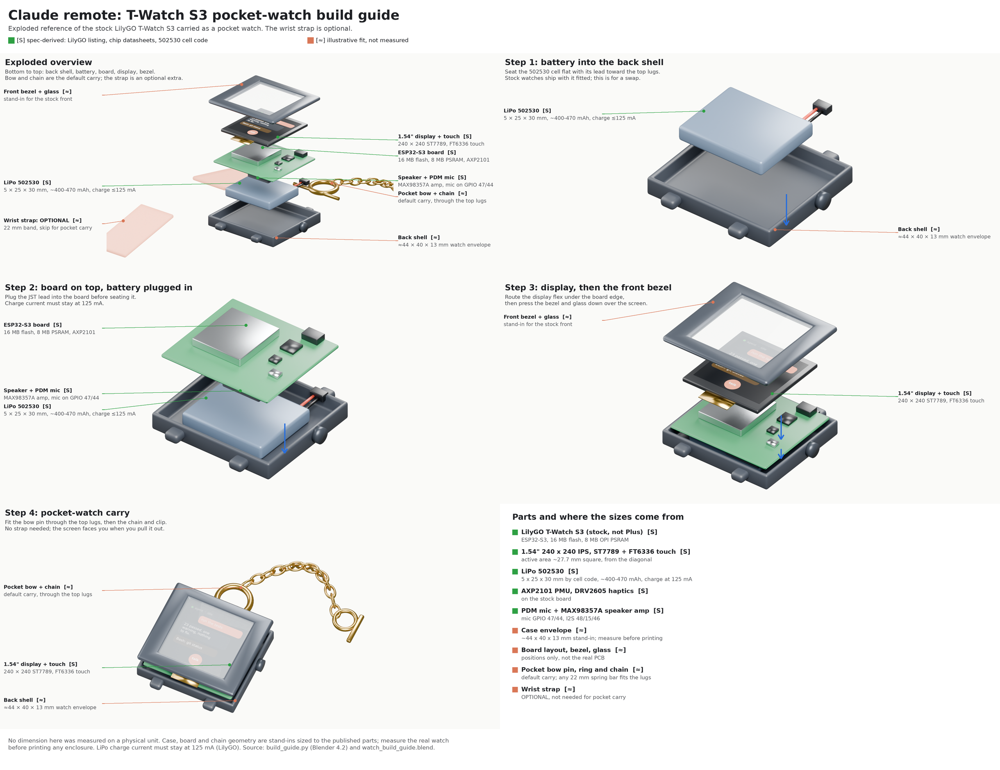

# T-Watch S3 pocket-watch build guide (Blender)

An exploded 3D reference of the stock LilyGO T-Watch S3 used as the Claude remote, carried as a
pocket watch on a bow ring and chain. The wrist strap is shown only as an optional ghost part.



| File | What it is |
| --- | --- |
| `out/watch_build_guide.blend` | Editable scene (Blender 4.2+), saved in the exploded pose, one collection per part |
| `out/watch_build_guide.glb` | Same model for web or slicer viewers |
| `out/build_guide.png` | Full-resolution guide sheet: overview, steps 1-4 and the parts list |
| `build_guide.py` | Builds the scene and renders the views |
| `compose_guide.py` | Draws the screen texture and composes the labeled sheet |

## Spec-derived vs illustrative

Nothing here was measured on a physical unit.

- **[S] spec-derived**: the board (ESP32-S3, 16 MB flash, 8 MB PSRAM), the 1.54" 240x240 ST7789
  display (active area ~27.7 mm square, from the diagonal), the 502530 LiPo (5 x 25 x 30 mm by cell
  code), the AXP2101, DRV2605, PDM mic and MAX98357A. These follow [hardware.md](../hardware.md).
- **[≈] illustrative**: the ~44 x 40 x 13 mm case envelope, the board layout, bezel and glass, the
  bow pin, ring and chain, and the strap. They are sized to fit the spec parts. Measure a real watch
  before you print an enclosure or a bow adapter.

## Rebuild

```bash
python compose_guide.py screen out/screen.png              # needs Pillow
blender -b -P build_guide.py -- out 64                     # 64 Cycles samples, ~2 min on 8 CPU cores
python compose_guide.py sheet out
```
